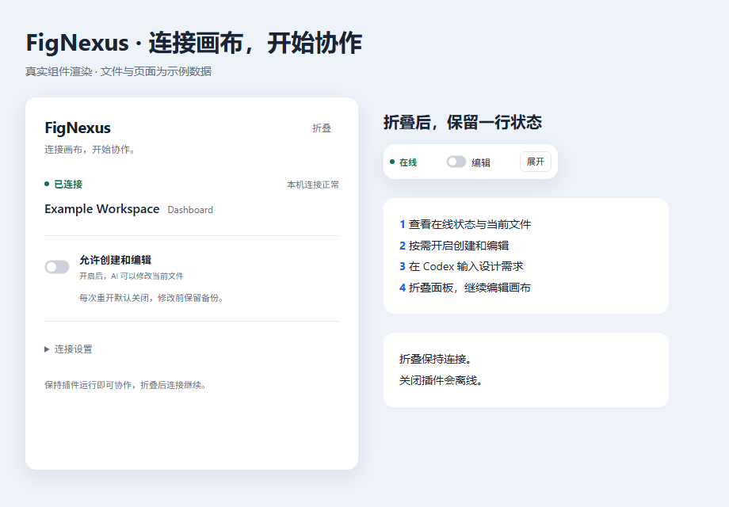

# FigNexus

**在 Codex 里说出设计需求，在 Figma 里得到可编辑的原生界面。**

FigNexus 连接 Codex 与正在运行的 Figma 桌面插件，可以读取画布、创建和修改界面、使用原生渐变和贝塞尔路径，并导出 PNG。文字、形状、曲线和组件都可以继续在 Figma 中调整。



> **0.3.8 · Windows x64 + Figma 桌面端 + Codex**。无需发布到 Figma 社区，无需 Figma PAT 或额外 AI API key。其他客户端未纳入本版本验收。

## 下载与首次安装

**请下载 [最新 Windows 安装包](https://github.com/amirage7/FigNexus/releases/latest)，不要下载源码 ZIP。** 包内含运行环境和编译好的插件，不用安装 Node.js、pnpm 或自行构建。


1. **双击“开始使用”。** 解压 `FigNexus-0.3.8-Windows.zip`，双击 `开始使用.cmd`。首次会自动进入安装配置预览，输入 `YES` 确认后完成安装、注册 Codex 接口、启动本机服务，并显示 Figma 导入路径。**不用单独运行 install.cmd。** 再次双击只启动已安装版本，不重复安装或修改配置。
2. **在 Figma 导入并配对。** 选择 `Plugins → Development → Import plugin from manifest`，粘贴显示的**安装目录/plugin/manifest.json** 路径，运行 FigNexus。首次安装后重启 Codex 一次；点击插件“配对本机”，核对六位码并确认，在线后开启编辑，在 Codex 说需求。无需 New plugin、空白插件或手动令牌。

**无 ID 直接导入已在真实 Figma 桌面端验证：成功导入、运行、在线，并通过原生只读 ping；导入前后 manifest 均没有 id。** 官方 [manifest 文档](https://developers.figma.com/docs/plugins/manifest/) 描述 ID 用于发布更新，[导入指南](https://help.figma.com/hc/en-us/articles/38457121114263-Create-a-Figma-Design-plugin-with-the-Figma-MCP-server-and-agentic-tools) 说明通过开发菜单导入 manifest。这里的可行性以实际验证为依据，不使用伪造 ID 或私有 API。


Codex 的 MCP 配置由安装器完成，不用额外安装另一款 Codex 插件或手动粘贴令牌。错过路径提示时双击安装目录的 `开始使用.cmd`。详见 [Windows 安装指南](docs/windows-install.md)。

## 日常使用

打开 Codex → 打开 Figma 文件并运行 FigNexus → 等待自动在线 → 按需开启编辑 → 在 Codex 说需求。

已保存配对会自动连接，不用每次打开助手或输入令牌。Codex 尚未运行时，也可以双击 `开始使用.cmd` 启动本机服务。

先检查连接：

> 使用 FigNexus 检查当前连接，告诉我正在打开的 Figma 文件、页面和选中节点，先不要修改画布。

创建界面：

> 使用 FigNexus，在当前页面新建一个 390×844 的登录页。用原生渐变作背景，文字和按钮保持可编辑，图标用原生矢量路径。完成后读取节点核对，再导出 PNG。

修改界面：

> 使用 FigNexus，把我选中的卡片改成蓝紫渐变，保留文字，调整间距，并在修改前生成备份。

也可以发送参考图，说明放在哪个页面、是新建还是修改已有 Frame。Codex 理解需求，FigNexus 执行画布操作；复刻效果取决于模型、参考图和需求清晰程度。

## 面板与权限

- **折叠：** 点“折叠”缩成 220×44 状态条，连接与任务继续运行。可随时展开，下次打开记住外观。
- **编辑：** 每次重新运行插件默认关闭写权限，由你在面板或状态条开启。
- **连接设置：** 重新配对、备用 HTTP 连接、清除本机配对都收在这里，日常无需操作。
- **删除：** 自动展开并显示本地确认，确认具体请求后才执行。修改前备份保留，恢复生成副本。
- **关闭：** Figma 关闭按钮会结束插件并离线。想少占位置请折叠。


## 已实现的能力

| 能力 | 当前范围 |
| --- | --- |
| 连接与读取 | 自动配对、重连；文件、页面、选择与节点查询 |
| 原生创建与编辑 | Frame、文字、矩形、椭圆、线条、Vector、Auto Layout |
| 渐变与视觉 | 线性、径向、角度、菱形渐变，描边、阴影、图片填充 |
| 路径 | 有界 M/L/C/Q/Z、贝塞尔曲线、闭合填充、圆角描边；不靠圆点或色条拼图 |
| 图片 | 指定本地 PNG/JPEG 导入，最多 2 MiB；原生裁剪、平铺填充 |
| 设计系统 | 本地组件与实例、变量集合、绑定与历史、多页面 |
| 备份与日志 | 原生节点备份、恢复为副本、脱敏本地审计日志 |
| PNG 预览 | Figma 原生导出、MCP 图片/资源、在途任务保留与取回 |

提供 25 个 MCP 工具，使用公开 Figma Plugin API 和严格操作白名单，没有任意脚本执行接口。内部 MCP 名称仍为 `figma-ai-bridge`，用于保留旧版本配置、配对和数据兼容。

## 已知限制与排查

**PNG 等待渲染：** Figma 最小化或后台运行时，原生 `exportAsync` 可能迟迟不返回。FigNexus 保留同一任务，避免重复堆积；稍后用相同参数取回，必要时恢复 Figma 前台。后台立即导出仍不能保证，等待提示不代表导出成功。编辑或换页后旧预览失效。

**离线：** 保持插件运行，打开 Codex 或 `开始使用.cmd`；仍失败时，在“连接设置”重新配对或尝试备用连接。3055 端口被旧版本占用时退出自己的旧服务，不要结束不认识的进程。

**无法编辑：** 确认文件有编辑权限，并开启本次插件的编辑开关。聊天授权不能代替插件本地开关。

**换电脑：** 在新机器重新安装并直接导入安装目录的 manifest，无需创建插件 ID。安装器隔离测试和本机真实验收已通过，仍建议在另一台干净 Windows 按首次流程检查一遍。

## 开发者

普通使用者不需要以下步骤。源码使用 TypeScript、React、Fastify、WebSocket 和 MCP SDK，需要 Node.js ≥22.16 与项目指定的 pnpm。

```powershell
pnpm install --frozen-lockfile
pnpm check
pnpm --filter @bridge/plugin check:main
pnpm test
pnpm build
pnpm smoke
```

`pnpm smoke` 使用模拟插件验证 25 工具，需要 3055 端口空闲。真实 Figma 试验脚本可能修改画布，运行前阅读脚本并使用测试文件。

默认直接导入 `apps/figma-plugin/dist/manifest.json`，不需要 ID。如需复用已有 Figma 分配的 ID，可选运行 `pnpm plugin:id <已有数字ID>` 再构建；不要提交自己的 ID，发行包会自动剥离本地 ID。Windows 安装包用 `pnpm build:windows` 构建，输出到被忽略的 `.bridge`。

目录：`apps/figma-plugin` 插件；`apps/bridge-server` 本机服务；`apps/pairing-helper` 确认助手；`packages/mcp-server` Codex 接口；`packages/protocol` 协议；`scripts/distribution` 安装器。

查看 [架构](docs/architecture.md) 和 [验证范围](docs/verification.md)。仓库不包含本地令牌、配对记录、用户画布或日志。第三方许可随安装包保留；本仓库暂未指定额外开源许可证。
