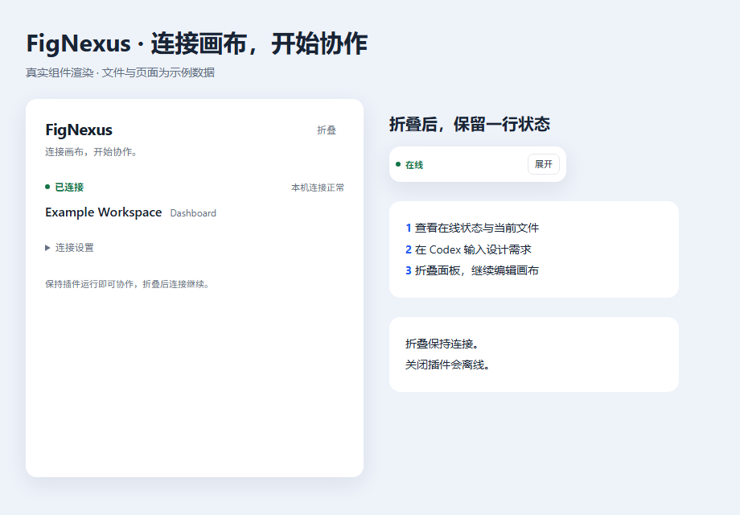
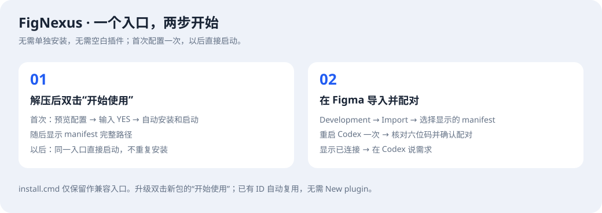
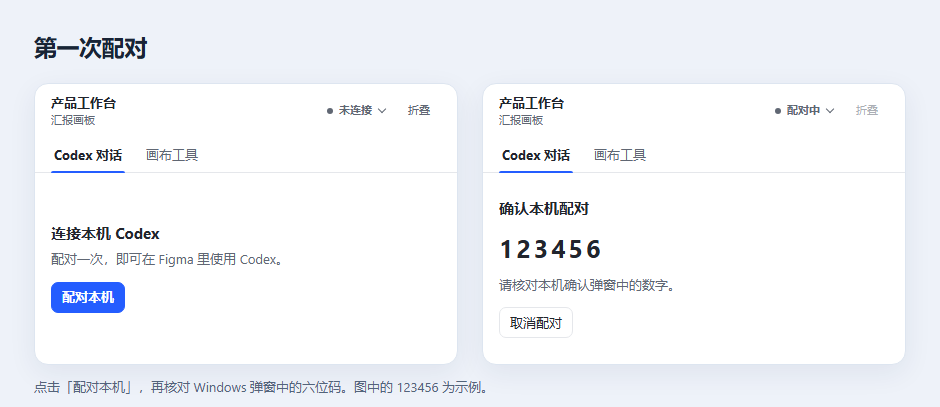

# FigNexus

**在 Codex 中描述需求，在 Figma 中创建可编辑的设计。**

FigNexus 连接 Codex 与 Figma，可以读取画布、创建和修改界面、导入图片、导出 PNG。文字、形状、渐变和矢量路径都能继续在 Figma 中调整。

支持 Windows x64、Figma 桌面端和 Codex。



## 安装

下载 [最新 Windows 安装包](https://github.com/amirage7/FigNexus/releases/latest)。安装包包含运行环境、Figma 插件和 Codex 连接配置。



1. 解压安装包，双击 **开始使用.cmd**。
2. 查看安装预览，输入 `YES`。安装完成后，窗口会显示 `manifest.json` 的完整路径。
3. 在 Figma 中选择 **Plugins → Development → Import plugin from manifest**，选择该路径的文件。
4. 运行 FigNexus，点击 **配对本机**，核对弹窗中的六位码并确认。
5. 重启 Codex，完成首次设置。

详细步骤见 [Windows 安装指南](docs/windows-install.md)。



## 使用

打开 Codex，再在 Figma 中运行 FigNexus。Codex 会自动启动本机服务，插件通过保存的配对自动连接。

插件显示“已连接”后，就可以在 Codex 中读取、创建和编辑画布。

**检查连接：**

> 使用 FigNexus，读取当前文件、页面和选中节点。

**创建界面：**

> 使用 FigNexus，在当前页面新建一个 390×844 的登录页。背景用蓝紫渐变，文字和按钮保持可编辑，图标用矢量路径。完成后导出 PNG。

**修改设计：**

> 使用 FigNexus，把选中的卡片改成蓝紫渐变，调整文字和按钮的间距。

**根据参考图复刻：**

发送图片，并说明目标页面和尺寸，例如：

> 使用 FigNexus，在当前页面新建 Frame，复刻这张图，尺寸为 1440×900。

## 在 Figma 里与 Codex 对话

本机需要能运行 `codex` 命令，并已通过 `codex login` 登录。连接后可在 FigNexus 的 **Codex 对话** 直接输入消息。

选中一个卡片，发送「这个卡片的间距怎么调？」，再追问「按刚才的建议修改」。回复会逐步显示。Codex 的画布工具只访问发出消息的插件实例和当时的页面，删除请求仍需要在插件里确认。

带文件标识的设计稿会在本机保留独立会话，重开插件可继续；Figma 未提供文件标识时，可以在本次插件运行中多轮对话。对话通过本机 Codex CLI 的账号运行。

## 画布工具

在 FigNexus 面板打开 **画布工具** 即可使用这些功能。

- **流程图连线** · 选中两个图层，创建直线或折线箭头。插件运行时随节点移动，选择箭头可反转方向。连线保留在画布上，重开插件时刷新。
- **批量建画板** · 创建最多 30 张画板，支持 16:9、4:3、竖屏、正方形、A4 和自定义尺寸。也可以复制选中画板并沿用原尺寸。
- **导出 PPTX** · 选中 1–30 张比例一致的画板，可填写文件名、调整页序、选择 1280 / 1920 / 3840 px 长边。图片版保留整页外观，可编辑版转为原生文本、线条、基础形状和线框表格，复杂图层优先以 SVG 保留。
- **插入表格** · 插入空表，或粘贴 Excel / CSV / Markdown，支持最多 24 列、30 行、240 格。默认透明底、细线边框，底纹可选。选中表格可调整总宽、总高及单独的列宽、行高，单元格文字可直接编辑。

## 面板操作

- **折叠：** 缩成小状态条，保持连接。
- **连接设置：** 点击顶部连接状态，管理配对或切换备用连接。
- **删除确认：** 查看具体删除请求，在插件中确认后执行。
- **备份恢复：** 修改前保存节点备份，恢复时生成副本。

使用期间保持插件打开；关闭插件会结束连接。

## 主要功能

| 功能 | 支持内容 |
| --- | --- |
| 画布读取 | 文件、页面、选中内容与节点查询 |
| 创建与编辑 | Frame、文字、形状、线条、矢量路径、Auto Layout |
| 视觉样式 | 线性、径向、角度、菱形渐变，描边与阴影 |
| 图片 | 本地 PNG/JPEG 导入，裁剪与平铺填充；单张上限 2 MiB |
| 设计系统 | 本地组件、实例、变量与绑定、多页面 |
| 备份与记录 | 节点备份、恢复副本、本地操作日志 |
| 预览 | PNG 导出与图片读取 |

## 常见问题

**插件离线**

确认 Codex 和 FigNexus 已打开。可以双击 `开始使用.cmd` 手动启动服务，或在插件的“连接设置”中重新配对。

**画布无法编辑**

确认 FigNexus 显示“已连接”，并检查你是否有当前 Figma 文件的编辑权限。

**修改文字、复制已有流程图**

使用独立编辑接口可直接修改原文字，或复制完整 Frame 后按后代 ID 修改副本，保留原图。结果逐项报告完成、失败和跳过；详见 [已有内容编辑](docs/editing-capabilities.md)。

**提示缺少有效 manifest ID 或无法使用私有插件数据**

编辑备份和变量接口依赖有效的本地插件身份。使用 Figma 实际分配的插件 ID 配置并重新加载插件，具体步骤见 [身份配置说明](docs/editing-capabilities.md#私有插件数据与-manifest-id)。

**PNG 导出等待较久**

Figma 在后台或最小化时，渲染可能暂停。将 Figma 切到前台，保持插件打开，再让 Codex 取回同一项导出任务。

**升级版本**

解压新安装包，双击 `开始使用.cmd`，再将安装完成后显示的 `manifest.json` 导入 Figma。配对和日志会保留。

## 开发

源码使用 TypeScript、React、Fastify、WebSocket 和 MCP SDK。开发环境为 Node.js ≥22.16，pnpm 版本见 `package.json`。

```powershell
pnpm install --frozen-lockfile
pnpm check
pnpm --filter @bridge/plugin check:main
pnpm test
pnpm build
pnpm smoke
```

构建后，在 Figma 导入 `apps/figma-plugin/dist/manifest.json`。`pnpm build:windows` 生成 Windows 安装包。

`pnpm smoke` 使用模拟插件验证接口，需要 3055 端口空闲。真实 Figma 验收脚本会操作画布，请在测试文件中运行。

项目结构、接口和验证记录见 [架构说明](docs/architecture.md) 与 [验证范围](docs/verification.md)。第三方许可随安装包提供；项目许可证尚待确定。
