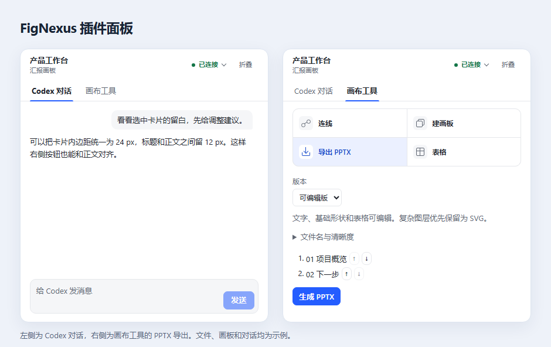

# FigNexus

FigNexus 把本机 Codex 接到 Figma。你可以让 Codex 读取选中的图层、创建界面或修改现有设计，也可以直接在插件里连线、建画板、插表格和导出 PowerPoint。创建的文字、形状和矢量路径可以继续在 Figma 里编辑。

运行环境为 Windows x64、Figma 桌面端和 Codex。

## 第一次启动

1. **下载安装包。** 到 [GitHub Releases](https://github.com/amirage7/FigNexus/releases/latest) 下载 Windows ZIP，完整解压。要使用下文所述的当前源码功能，可以[从源码打包](#从源码打包)。
2. **双击 `开始使用.cmd`。** 看一眼安装预览，输入大写 `YES` 回车。安装器会备份并合并 Codex 配置、启动本机服务，然后显示 `manifest.json` 的完整路径。
3. **在 Figma 导入并运行。** 打开一个可编辑的 Figma Design 文件，进入 **Plugins → Development → Import plugin from manifest**。在文件选择框里粘贴上一步显示的路径。导入后，从 **Plugins → Development** 运行 **FigNexus**。
4. **完成本机配对。** 切到插件的 **Codex 对话**，点 **配对本机**。核对插件和 Windows 弹窗上的六位数字，确认相同后点 **是**。保留 **下次自动连接**，以后重开插件会复用这次配对。
5. **完全退出并重启 Codex 一次。** 插件显示 **已连接** 后，可以在 Codex 发一句「使用 FigNexus，告诉我当前 Figma 文件、页面和选中了哪些图层」，确认连到正确的画布。


安装路径和导入窗口见 [Windows 安装指南](docs/windows-install.md)。

## 以后怎么启动

**打开 Codex → 在 Figma 运行 FigNexus → 等待显示「已连接」。** Codex 会按需启动本机服务，插件用保存的配对自动连回去。

| 遇到的情况 | 怎么做 |
| --- | --- |
| 想先启动本机服务，或插件提示离线 | 双击解压目录或已安装目录里的 `开始使用.cmd`，回到插件点 **重新连接**。已安装的同一版本会直接启动。 |
| 自动连接失败 | 点插件顶部的连接状态，确认 **下次自动连接** 已勾选。需要时点 **重新配对**，再次核对六位码。 |
| 面板挡住画布 | 点 **折叠**，小状态条会保留连接。重新运行插件可恢复关闭后的连接。 |
| 换了新安装包 | 解压新包并双击 **开始使用.cmd**，按提示导入新安装目录的 `manifest.json`，再完全退出并重启 Codex。安装器会保留本机配对和日志。 |

## 现在能做什么

### 用 Codex 读写 Figma 画布

在 Codex 桌面端描述任务，或在 Figma 的 **Codex 对话** 里直接询问。使用插件内对话前，请在本机终端确认 `codex --version` 可运行，并用 `codex login` 登录。回复会逐步显示，可继续追问。有文件标识的设计稿可以在重开插件后接着聊。

| 功能 | 可以怎么用 |
| --- | --- |
| 读取画布 | 查看文件、页面、选区和图层的属性，按名称或条件查找节点。 |
| 创建界面 | 创建 Frame、文字、矩形、椭圆、线条和矢量路径，设置 Auto Layout、渐变、描边和阴影。也可以给 Codex 一张参考图，让它在新画板中搭出可编辑结构。 |
| 编辑已有设计 | 直接替换文字，修改位置、尺寸、填充或排列。可以复制整个 Frame，再修改副本里的指定图层。批量编辑会逐项报告完成、失败和跳过。 |
| 组件、变量和页面 | 创建本地组件和实例，管理变量集合、值与绑定，创建或切换页面。 |
| 导入图片、导出预览 | 导入单张不超过 2 MiB 的本地 PNG/JPEG，作为 Figma 图片填充。也可以把画板导出为 PNG 预览。 |
| 删除、备份和恢复 | 删除前在 Figma 插件里确认。可查看节点备份并恢复为副本，也可查看本地操作记录。备份和变量历史等操作需要有效的 Figma 插件 ID。详见[已有内容编辑](docs/editing-capabilities.md)。 |

可以先选中一个 Frame，再试这句：

> 使用 FigNexus，复制选中的 Frame，把副本放到右侧，将标题改为「项目概览」，最后导出副本的 PNG 预览。

### 在 Figma 里使用画布工具



在插件里切到 **画布工具**，选择需要的操作。

| 工具 | 操作 |
| --- | --- |
| **连线** | 选中两个图层，添加直线或折线箭头。插件运行时，连线随图层移动。选中已有连线可以反转箭头。 |
| **建画板** | 一次创建 1–30 张画板，支持 16:9、4:3、竖屏、正方形、A4 和自定义尺寸。也可以以当前选中的画板为模板。 |
| **导出 PPTX** | 选中 1–30 张比例一致、未旋转的画板，可调整页序、文件名和清晰度。**图片版**按整页渲染。**可编辑版**保留支持的文字、线条、基础形状和表格，复杂图层优先保留为 SVG。生成完成后点击 **保存 PPTX**。 |
| **表格** | 插入空表，或粘贴 Excel 单元格、CSV 或 Markdown 表格。表格最多 30 行、24 列、240 格。可编辑单元格文字，调整行高、列宽和底纹。 |

导出 PNG 或 PPTX 时，请保持 Figma 在前台并让插件继续运行。

## 从源码打包

在 Windows x64 上准备 Node.js 22.16.0 和 `package.json` 指定的 pnpm 版本。在仓库根目录运行：

```powershell
pnpm install --frozen-lockfile
pnpm build
pnpm build:windows
```

打包命令会输出 ZIP 的路径，默认位于 `.bridge/`。完整解压后，按[第一次启动](#第一次启动)操作。仅调试 Figma 插件时，`pnpm build` 后可在 Figma 导入 `apps/figma-plugin/dist/manifest.json`。

开发验证用 `pnpm check`、`pnpm --filter @bridge/plugin check:main`、`pnpm test` 和 `pnpm smoke`。冒烟测试需要本机 3055 端口空闲。项目结构和测试范围见[架构说明](docs/architecture.md)与[验证记录](docs/verification.md)。第三方许可随安装包提供，项目许可证尚待确定。
