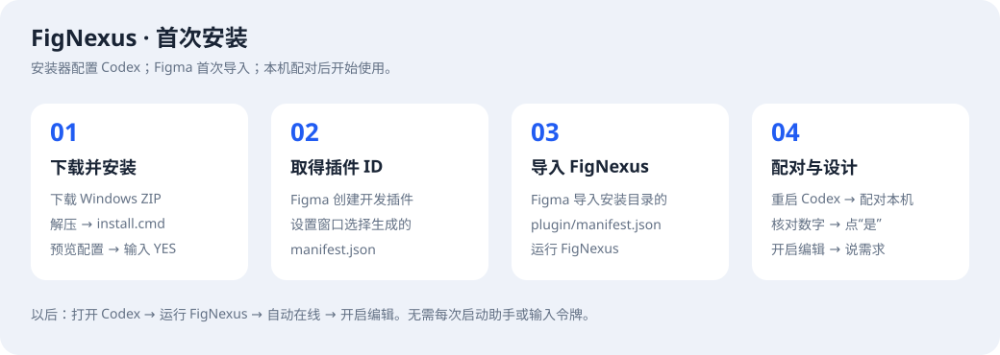
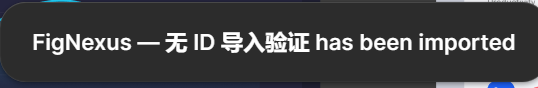
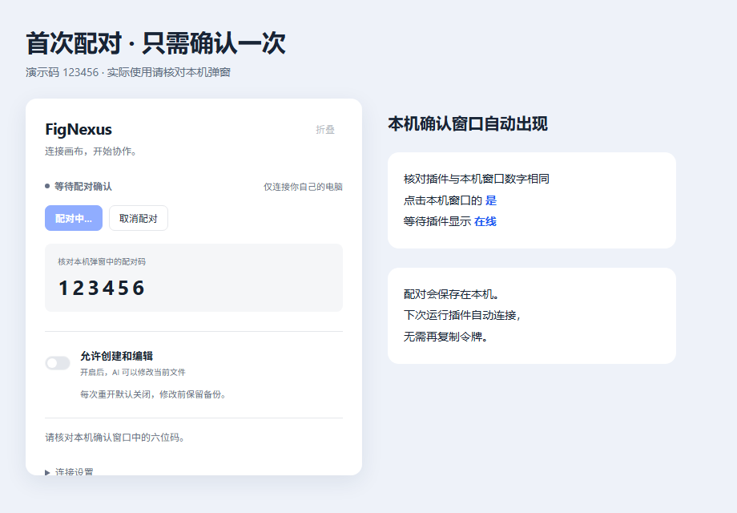

# FigNexus Windows 安装指南

0.3.6 支持 Windows x64、Figma 桌面端与 Codex。包内已含运行环境、依赖和插件编译结果，不需要自行构建或额外 API key。

## 1. 安装

从 [Releases](https://github.com/amirage7/FigNexus/releases/latest) 下载 `FigNexus-0.3.6-Windows.zip`，完整解压，双击 `install.cmd`。查看配置预览，输入大写 `YES` 回车。

安装器备份并合并 Codex MCP 配置，保留其他服务，启动本机服务，并显示待导入的 `manifest.json` 完整路径。无需手工编辑 Codex 配置，不用另外安装 Codex 插件。

## 2. 直接导入 FigNexus

在 Figma 桌面端打开可编辑文件，选择 `Plugins → Development → Import plugin from manifest`。

在文件窗口的“文件名”栏粘贴安装器显示的完整路径，选择**安装目录/plugin/manifest.json**，然后运行 **FigNexus**。

**不用 New plugin，不用创建空白插件，不用选择别的 manifest 提取 ID。** 无 ID 导入和运行已通过真实 Figma 验证，导入前后文件没有被补写 ID，在线只读 ping 成功。

默认安装目录：`%LOCALAPPDATA%/FigmaAIBridge/releases/<版本标识>`。错过提示时双击安装目录的 `开始使用.cmd`；也可运行 `setup-plugin.ps1` 再显示导入路径。

## 3. 配对并设计

重启 Codex 一次。在插件点击“配对本机”，核对插件与自动弹出的本机窗口六位数字相同，点击“是”。无需复制令牌或自己打开助手。

在线后开启“允许创建和编辑”，在 Codex 说：“使用 FigNexus，在当前页面创建一个登录页。”

## 日常使用

打开 Codex → 在 Figma 运行 FigNexus → 自动在线 → 按需开启编辑 → 在 Codex 说需求。

点击“折叠”保留小状态条即可继续连接；关闭插件会离线。重开后编辑权限默认关闭。Codex 未启动时，也可双击 `开始使用.cmd` 启动服务。

## 升级与已有 ID

解压新包并运行 `install.cmd`，安装器会保留配对与日志，更新属于本安装的 MCP 配置。然后在 Figma 导入新安装目录的 manifest；**升级也不需要 New plugin**。旧服务占用 3055 时，关闭自己的旧版本后再启动。

旧版本已有 Figma 分配的 ID 时，安装器从上次安装记录自动读取并保存到数据目录 `plugin-id.json`，后续升级自动复用。同一 ID 不会要求重复选择文件；无 ID 安装不会生成或伪造 ID。

从非安装器的旧开发插件迁移时，可选运行 `setup-plugin.ps1 -GeneratedManifest "旧插件的manifest完整路径"`，复用已有 ID。该参数不是首次安装的必填步骤。冲突或损坏的身份记录会报错并保留原文件，不能随意填数字修复。

数据目录仍为 `%LOCALAPPDATA%/FigmaAIBridge/data`，保留历史目录名以兼容升级。新版本 manifest 路径不同，需要重新导入；如果新导入实例未自动在线，点击“配对本机”即可，不要创建空白插件。

## 卸载与排查

双击 `uninstall.cmd`，备份配置并移除本安装的 Codex 条目，保留数据和程序，不删除设计或结束其他进程。

配置发生冲突时，安装器保留原配置并报告；不要删除其他服务。自定义安装可使用 PowerShell 的 `-CodexHome` 和 `-DataRoot` 参数。重新显示导入说明时，自定义目录也应传同一个 `-DataRoot`。

配对弹窗可能在其他窗口后面；取消后等 10 秒再试。“连接设置”有重新配对、备用连接和清除配对。

Figma 后台或最小化时 PNG 导出仍可能等待渲染。任务会保留，可以稍后取回；必要时恢复 Figma 前台。在线不代表 PNG 已完成。其他客户端未验收。

## 官方依据与实测范围

[官方 manifest 文档](https://developers.figma.com/docs/plugins/manifest/) 描述 ID 为发布更新使用的标识；[官方开发插件导入指南](https://help.figma.com/hc/en-us/articles/38457121114263-Create-a-Figma-Design-plugin-with-the-Figma-MCP-server-and-agentic-tools) 说明桌面端通过 Import plugin from manifest 导入。

上述文档本身没有明确规定无 ID 的所有行为；本流程以 2026-10-14 的真实导入、运行和连接结果为依据。只使用公开导入菜单和 Plugin API，没有调用私有注册 API。安装器隔离验收不等同于所有干净 Windows 首次登录环境都已测试。
